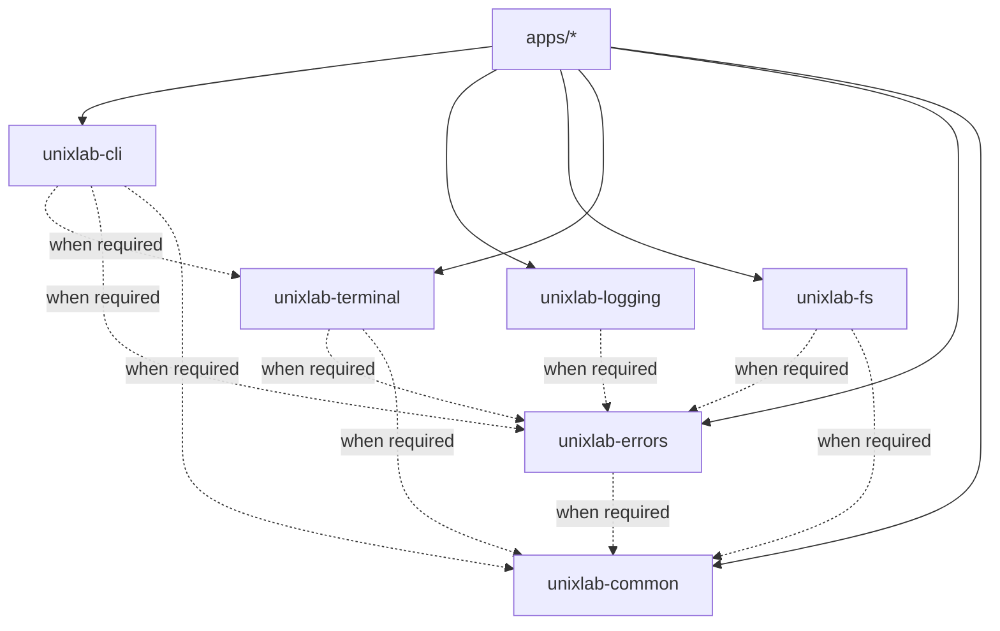

# Architecture

## Goals

UnixLab provides production-quality, cross-platform implementations of
classic Unix tools while remaining understandable to systems programmers.
Correctness, predictable resource use, native I/O behavior, and maintainable
design take priority over feature count.

## Workspace structure

```text
UnixLab/
├── apps/                    # Independently releasable tools
├── libs/
│   ├── cli/                 # Shared CLI conventions
│   ├── common/              # Proven domain-neutral primitives
│   ├── errors/              # Diagnostic and exit contracts
│   ├── fs/                  # Portable filesystem boundaries
│   ├── logging/             # Developer diagnostic policy
│   └── terminal/            # Terminal capabilities and rendering policy
├── docs/
│   ├── decisions/           # Architecture decision records
│   ├── architecture.md
│   └── engineering-guidelines.md
├── examples/                # Compilable shared-library examples
├── scripts/                 # Local quality automation
└── .github/                 # CI and collaboration configuration
```

The root is a Cargo virtual workspace. Workspace package metadata, lint policy,
release defaults, and internal dependency paths are declared once in the root
manifest. Applications and libraries inherit those settings.

## Dependency model

Dependencies flow from applications toward small libraries. Shared libraries
must never depend on an application.



Dashed edges are allowed directions, not dependencies added in advance. At the
foundation stage all six libraries are dependency-free. A dependency is added
only when real code requires it.

Cycles are forbidden. `common` is the lowest layer and must not become a
catch-all. External dependencies are declared only by crates that use them;
workspace dependency entries centralize versions after a dependency is
selected.

## Application shape

Each tool is one package under `apps/<name>` with both library and binary
targets:

```text
apps/<name>/
├── Cargo.toml
├── README.md
├── src/
│   ├── lib.rs              # Domain logic and testable orchestration
│   └── main.rs             # Argument, I/O, diagnostics, and exit wiring
├── tests/                  # Black-box CLI and compatibility tests
└── benches/                # Evidence-driven performance benchmarks
```

The binary target stays thin. Domain logic accepts explicit inputs and output
sinks where practical, making behavior testable without subprocesses. Black-box
tests still exercise the real executable.

## Library responsibilities

| Crate | Owns | Does not own |
| --- | --- | --- |
| `unixlab-cli` | Common help/version and process-boundary conventions | Tool-specific argument models or business logic |
| `unixlab-errors` | Diagnostic rendering and exit-status contracts | One universal error type |
| `unixlab-logging` | Developer diagnostic initialization and policy | Normal stdout/stderr command output |
| `unixlab-fs` | Proven portable filesystem seams | A wholesale wrapper around `std::fs` |
| `unixlab-terminal` | TTY/capability behavior and terminal rendering policy | General UI or application output |
| `unixlab-common` | Small, stable concepts shared by multiple consumers | Miscellaneous helpers or platform policy |

## Portability

Linux, macOS, and Windows are first-class targets. Portable behavior is the
default; platform-specific code is isolated in narrow modules with equivalent
tests and documented semantic differences.

Unix byte-oriented paths and Windows wide paths must not be forced through
UTF-8 strings. Newline, signal, permission, symlink, terminal, and process
behavior require explicit cross-platform decisions. A tool may expose a
platform-specific capability, but unsupported behavior must fail clearly.

## Documentation-first change process

A new application begins with a design document in `docs/design/` describing:

1. Supported behavior and intentional incompatibilities.
2. Command-line and exit-status contract.
3. Streaming and memory model.
4. Platform differences.
5. Test and compatibility strategy.
6. Dependency and security considerations.

Repository-wide decisions use an architecture decision record in
`docs/decisions/`. Code and documentation evolve in the same pull request.

